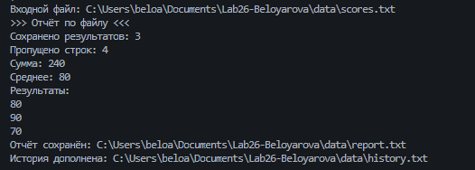

# Практическая работа №26

Автор: Белоярова Александра
Группа: ИСП-251

## Тема

Работа с текстовыми файлами в C#.

## Что реализовано

- пути к файлам через Path.Combine;
- чтение результатов из файла в UTF-8;
- проверка строк через TryParse;
- формирование и сохранение отчёта;
- добавление записи в историю запусков;
- обработка ошибок файловых операций.

## Короткие ответы

1. От какой папки отсчитывается относительный путь?

Ответ: От текущей рабочей папки программы. При запуске dotnet run из папки проекта это папка проекта поэтому data/scores.txt указывает на папку data внутри проекта

2. Чем отличаются WriteAllText и AppendAllText?

Ответ: WriteAllText создаёт файл или полностью перезаписывает существующий, а AppendAllText сохраняет старое содержимое и добавляет новый текст в конец.

3. Чем ошибка чтения файла отличается от некорректной строки внутри файла?

Ответ: Ошибка чтения это исключение его обрабатывают через try catch. Некорректная строка внутри успешно прочитанного файла обычная ситуация с данными её проверяют через TryParse и пропускают

## Файлы программы

- data/scores.txt — входные результаты;
- data/report.txt — последний отчёт;
- data/history.txt — история запусков.
Запускать dotnet run из папки проекта.

## Результат

